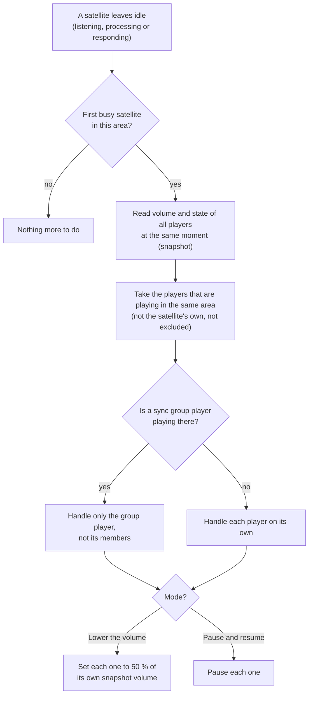
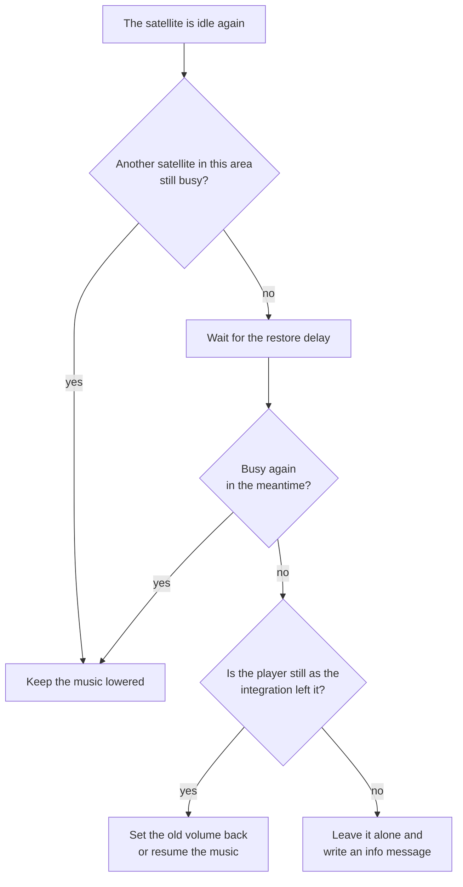

# Behavior Guide

This page describes what Satellite Controller does, from the user's point of view: when the music in a room is lowered or paused, which players are affected, and when everything goes back to normal.

For the design background and the open points see [plan.md](plan.md).

---

## Contents

- [The idea in one paragraph](#the-idea-in-one-paragraph)
- [Flow at a glance](#flow-at-a-glance)
- [What starts it](#what-starts-it)
- [Which players are affected](#which-players-are-affected)
- [What happens to the music](#what-happens-to-the-music)
- [When the music comes back](#when-the-music-comes-back)
- [Several satellites and several rooms](#several-satellites-and-several-rooms)
- [Sync group players](#sync-group-players)
- [Synchronized players](#synchronized-players)
- [When someone else changes the music](#when-someone-else-changes-the-music)
- [Restarts and unloading](#restarts-and-unloading)
- [Activity and log](#activity-and-log)
- [Options](#options)
- [Quick reference](#quick-reference)

---

## The idea in one paragraph

When a voice satellite in a room is listening or speaking, the other players in that room that are playing music get quieter (or are paused). When the satellite is idle again, they go back. The satellite itself lowers its own music, this integration does not touch it.

---

## Flow at a glance

When a satellite becomes busy:

When the satellite is quiet again:

---

## What starts it

Only the state of an ESPHome Assist satellite (`assist_satellite` entity of the ESPHome integration) counts.

| Satellite state | Meaning | Area is |
|-----------------|---------|---------|
| `listening` | The satellite streams your speech to Home Assistant (after the wake word or a button press) | **busy** |
| `processing` | Home Assistant works on the request | **busy** |
| `responding` | The satellite speaks the reply or an announcement | **busy** |
| `idle` | Waiting for a wake word | quiet |
| `unavailable` / `unknown` | The satellite is gone | quiet |

Details:

- The room is the **area** of the satellite: the area of the entity, or if it has none, the area of its device. A satellite without an area is ignored. A satellite of another integration is ignored.
- An area becomes busy when its **first** satellite leaves `idle`. Nothing more happens while further satellites in the same area join.
- The music is lowered when Home Assistant reports `listening`. Home Assistant does not tell about the wake word before that, so there is a short delay compared with the satellite's own ducking.

---

## Which players are affected

A player is lowered or paused only if **all** of these are true:

| Condition | Why |
|-----------|-----|
| It is an ESPHome or Music Assistant (Sendspin) `media_player` | Other players are not touched |
| It is in the **same area** as the busy satellite (own area, else the area of its device) | Other rooms keep their music |
| Its state is `playing` | Paused, stopped, off and unavailable players are left alone |
| It supports setting the volume (mode *Lower the volume*) or pausing (mode *Pause and resume*) | Otherwise the command would fail |
| It is not the satellite's own player (same device as the busy satellite) | The satellite lowers its own music |
| It is not in the option *Players that are never lowered* | Your choice |
| It is not a member of a sync group player that is lowered instead | The group player is set, its members are not, otherwise they would be lowered twice (see [Sync group players](#sync-group-players)) |

---

## What happens to the music

The mode is set in the options.

### Lower the volume (default)

1. All matching players are read **at the same moment**: their volumes are the snapshot.
2. Each player gets a new volume: its **own** snapshot volume minus the set share (default 50 %). A player at 60 % goes to 30 %, a player at 40 % goes to 20 %.
3. The targets are computed only from the snapshot, never from a volume that an earlier change may have moved. If some players are synchronized behind the scenes, the reduction is not applied twice.
4. A player with volume 0 is left alone.

### Pause and resume

Every matching player is paused. Resuming is described below. Pausing needs the pause feature of the player, not volume control.

### A player that starts while the area is busy

If a player in the busy area starts playing after the satellite became busy, it is lowered (or paused) at that moment, in the same way.

---

## When the music comes back

When the **last** busy satellite in the area is `idle` again (or unavailable), after the *Restore delay* (default 0 s):

| Mode | What happens |
|------|--------------|
| Lower the volume | Each lowered player is set back to its snapshot volume |
| Pause and resume | Each paused player is resumed, but only if it is still `paused` |

- If the satellite becomes busy again during the restore delay, nothing is restored and the area stays busy. This is how a follow-up question keeps the music down.
- While one satellite of the area is busy, the music of that area stays lowered. If a second satellite in the same area is busy, the music comes back only after both are idle.

---

## Several satellites and several rooms

- Each area is handled on its own. A satellite only affects players in its own area.
- Two busy satellites in different areas lower both rooms independently.
- A satellite that moves to another area while busy ends the old area and starts the new one.

---

## Sync group players

A Sendspin **sync group player** is a player of its own that has members. It is recognised as a player that lists group members but is not one of them.

| Situation | What is lowered |
|-----------|-----------------|
| The group player is playing, and it or one of its members is in the area | Only the **group player**. Its members are not touched |
| The group player is not playing | The members, each on its own (the normal rules) |
| The group player or one of its members is in the options list of excluded players | The members, each on its own. The group is left out |
| One of its members is the busy satellite's own player | The members, each on its own. The satellite's own player stays untouched |
| The group player cannot set the volume (or pause) | The members, each on its own |

Details:

- The group player is handled like any other player: lowered by the set share (or paused), restored afterwards, left alone if someone else changed it.
- The group player may have no area of its own. It then counts as being in the area if one of its members is.
- A group can reach into other rooms. Lowering the group player lowers all of its members, also those in other rooms. This is a property of the group.
- Music Assistant sets the members in proportion to the **highest** member volume. Therefore the volume that is lowered and restored is half of the highest member volume (the volume the group player itself reports is their average). If no member volume is known, the volume of the group player is used. With members at different volumes, each member ends up at the same share of its own volume and is restored to its old volume.
- In mode *Pause and resume* the group player is paused and resumed, not its members.

---

## Synchronized players

Sendspin players can be put together temporarily, and some players follow the volume of others. The integration does not try to know that:

- Apart from a sync group player and its members, every player is handled on its own, from the one snapshot.
- If players are synchronized, they can end up at the same value after the change (the one that was set last). Exactly 50 % per player is then not possible. This is a limit of the players, not of the integration.
- When restoring, a player counts as unchanged if its volume is **any** of the lowered volumes, because a synchronized player can end up at the volume of another one.

---

## When someone else changes the music

The integration does not lock the volume and does not fight changes.

| What happens while the music is lowered or paused | Result when the area is quiet again |
|---------------------------------------------------|--------------------------------------|
| Someone changes the volume to a value that is none of the lowered volumes | The player is **not restored** and keeps what was set. An info message is written to the log |
| Someone resumes or stops a paused player | The player is **not resumed**. An info message is written to the log |
| The player became unavailable | Nothing is restored for it |

---

## Restarts and unloading

- The lowered and paused players are stored. After a restart of Home Assistant, they are restored right away (with the same rules as above), so the music does not stay quiet.
- When the integration is unloaded or reloaded (for example after changing the options), all lowered and paused players are restored first.

---

## Activity and log

- Every successful volume change, pause and resume is added to the **Activity** (logbook) of that player and its device. The text names the integration, for example *Media Player volume lowered by Satellite Controller from 60 % to 30 % because a satellite in the room is busy*. Home Assistant shows the player's name as the subject, so the integration's name is part of the text.
- If a service call fails, a warning is written to the log and there is no activity entry.
- The debug log of `custom_components.satellite_controller` shows every decision: which players were found or ignored and why, the planned changes, every service call, and the restore.

---

## Options

| Option | Default | Meaning |
|--------|---------|---------|
| What to do with the music | Lower the volume | *Lower the volume* or *Pause and resume* |
| Lower the volume by | 50 % | Share of its **own** volume each player loses. Only for *Lower the volume* |
| Restore delay | 0 s | Seconds to wait after the satellite is idle before restoring |
| Players that are never lowered | none | Players the integration leaves alone |

---

## Quick reference

| Situation | Music in the room of the satellite |
|-----------|------------------------------------|
| Satellite `idle` | Unchanged |
| Satellite `listening`, `processing` or `responding` | Playing players lowered by half of their own volume (or paused) |
| Satellite listens again within the restore delay | Stays lowered |
| Last satellite of the area `idle` again | Restored (or resumed) |
| Player started while the satellite is busy | Lowered (or paused) at once |
| Player is not playing, has no volume control, or is the satellite's own | Not touched |
| A sync group player is playing in the room | Only the group player is lowered, not its members |
| Volume changed by someone else while lowered | Not restored, info message |
| Satellite in another room | Music in this room not touched |
| Home Assistant restarts while lowered | Restored at startup |
